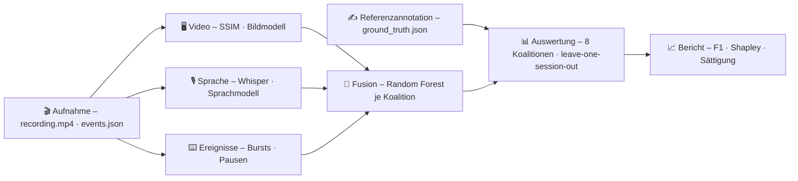

# DocuPilot

**Software-Workflows aufzeichnen und automatisch in Handlungsschritte zerlegen –
aus Bildschirm, Sprache und Eingaben.**

[](https://github.com/mueller-marcel/docu-pilot/actions/workflows/pull-request.yml)


---

Wer eine Anleitung für eine Software schreibt, zerlegt einen Arbeitsablauf in
Schritte. DocuPilot nimmt diesen Ablauf auf und findet die Schritte selbst:
dort, wo die Person ein Teilziel abschließt und das nächste beginnt.

Dafür werten drei unabhängige **Modalitäten** dieselbe Aufnahme aus:

| | Modalität | Was sie sieht |
|:-:|---|---|
| 🖥️ | **Video** | Ruhephasen und Änderungen des Bildschirms; ein Bildmodell beurteilt, ob eine Änderung ein neues Teilziel beginnt |
| 🎙️ | **Sprache** | Das laut kommentierte Vorgehen, transkribiert mit Whisper; ein Sprachmodell beurteilt jeden Satz im Zusammenhang |
| ⌨️ | **Ereignisse** | Maus- und Tastatureingaben, gebündelt zu Bursts; lange Pausen deuten auf die Planung eines neuen Schritts |

Neben der Segmentierung beantwortet DocuPilot die Frage: **Welchen
Informationsbeitrag leistet jede Modalität – und ab wann bringt eine weitere
keinen relevanten Gewinn mehr?**

## So funktioniert es



1. **Aufnehmen** – Bildschirm (10 fps), Mikrofon und jede Eingabe laufen auf
   einer gemeinsamen Uhr.
2. **Annotieren** – Im Annotationsfenster werden die Referenzgrenzen gesetzt:
   am ersten wahrnehmbaren Hinweis auf ein neues Teilziel (nach Kurby & Zacks 2008).
3. **Segmentieren** – Jede Modalität liefert unabhängig eine Evidenzkurve
   für Handlungsgrenzen.
4. **Auswerten** – Alle acht Kombinationen der Modalitäten werden
   leave-one-session-out gegen die Referenz bewertet; Shapley-Werte zerlegen das
   Ergebnis in die Beiträge der Modalitäten.

## Highlights

- 🧩 **Strikt unabhängige Modalitäten** – kein Detektor liest die Daten eines
  anderen, damit die Beiträge sauber zurechenbar bleiben.
- 🔒 **Kein Informationsleck** – jeder datengetriebene Parameter wird je Fold
  nur auf den Trainingssessions bestimmt.
- 📐 **Begründete Statistik** – 95-%-Konfidenzintervalle über Sessions, eine
  SESOI von einer Grenze, exakte Shapley-Werte aus dem vollfaktoriellen Design.
- 💾 **Reproduzierbar** – jedes Modellurteil wird neben der Aufnahme gecacht; ein
  zweiter Lauf kostet keine Modellaufrufe.
- 📄 **Bericht in Fenster und PDF** – dieselben Abbildungen aus denselben
  Zahlen.

## Schnellstart

**Voraussetzungen:** [uv](https://docs.astral.sh/uv/) (installiert bei Bedarf auch
Python 3.14) · `ffmpeg`/`ffprobe` im `PATH` · Zugang zur Anthropic-API (nur für die
Segmentierung)

```bash
git clone https://github.com/mueller-marcel/docu-pilot.git
cd docu-pilot
uv sync
uv run docupilot
```

Zugangsdaten liest DocuPilot aus der Umgebung oder aus einer `.env` im
Projektverzeichnis:

```ini
ANTHROPIC_API_KEY=...
# optional – dasselbe Modell für Sprache und Bild
DOCUPILOT_MODEL=claude-sonnet-5
```

## Projektstruktur

```text
src/docupilot/
├── recording/      Aufnahme: ffmpeg, Eingabeprotokoll, Session, Referenzannotation
├── segmentation/   eine Evidenzkurve je Modalität: video · audio · events
├── evaluation/     Experiment, Fusion, Kalibrierung, Metriken, Statistik, Bericht
├── ui/             PySide6-Fenster, Diagramme, PDF-Export
└── config.py       jede Einstellung mit ihrer Herkunft
tests/              Tests der Rechenwege hinter den Ergebnissen
docs/               technische Dokumentation (Sphinx)
```

## Dokumentation

Die technische Dokumentation – Architektur, Konzepte, Datenformate,
Konfiguration und API-Referenz – liegt in [`docs/`](docs/) und wird mit Sphinx
gebaut:

```bash
uv sync --group docs
uv run sphinx-build -b html docs docs/_build/html
```

Danach `docs/_build/html/index.html` öffnen.

## Entwicklung

```bash
uv sync                 # inklusive Gruppe dev
uv run ruff check .     # Lint
uv run pytest           # Tests
```

Die CI prüft jeden Pull Request: Lint und Paketbau, Tests und einen
Dokumentationsbuild, bei dem jede Warnung als Fehler zählt.
