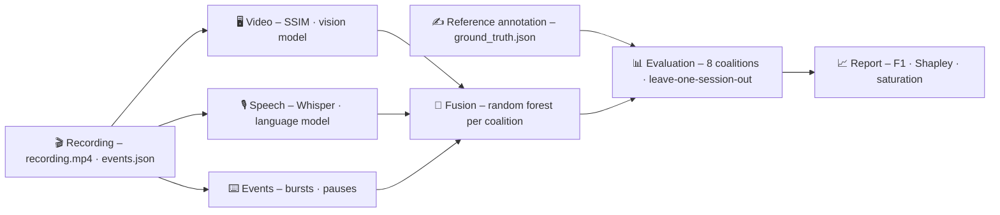

# DocuPilot

**Record software workflows and break them into action steps automatically –
from screen, speech and input.**

[](https://github.com/mueller-marcel/docu-pilot/actions/workflows/pull-request.yml)


---

Anyone who writes a manual for a piece of software breaks a workflow into
steps. DocuPilot records that workflow and finds the steps by itself: where
the person completes one sub-goal and begins the next.

To do so, three independent **modalities** analyse the same recording:

| | Modality | What it sees |
|:-:|---|---|
| 🖥️ | **Video** | Rest phases and changes of the screen; a vision model judges whether a change begins a new sub-goal |
| 🎙️ | **Speech** | The procedure as commented aloud, transcribed with Whisper; a language model judges each sentence in context |
| ⌨️ | **Events** | Mouse and keyboard input, grouped into bursts; long pauses point to the planning of a new step |

Beyond the segmentation, DocuPilot answers the question: **What information
does each modality contribute – and from which point does another one bring
no relevant gain any more?**

## How it works



1. **Record** – screen (10 fps), microphone and every input run on one shared
   clock.
2. **Annotate** – the reference boundaries are set in the annotation window:
   at the first perceivable hint of a new sub-goal (after Kurby & Zacks 2008).
3. **Segment** – each modality independently yields an evidence curve for
   action boundaries.
4. **Evaluate** – all eight combinations of the modalities are scored
   leave-one-session-out against the reference; Shapley values break the
   result down into the contributions of the modalities.

## Highlights

- 🧩 **Strictly independent modalities** – no detector reads another one's
  data, so the contributions stay cleanly attributable.
- 🔒 **No information leak** – every data-driven parameter is determined per
  fold on the training sessions only.
- 📐 **Justified statistics** – 95 % confidence intervals over sessions, a
  SESOI of one boundary, exact Shapley values from the full factorial design.
- 💾 **Reproducible** – every model judgement is cached next to the recording;
  a second run costs no model calls.
- 📄 **Report in window and PDF** – the same figures from the same
  numbers.

## Quick start

**Prerequisites:** [uv](https://docs.astral.sh/uv/) (also installs Python 3.14
if needed) · `ffmpeg`/`ffprobe` on the `PATH` · access to the Anthropic API (only
for the segmentation)

```bash
git clone https://github.com/mueller-marcel/docu-pilot.git
cd docu-pilot
uv sync
uv run docupilot
```

DocuPilot reads credentials from the environment or from a `.env` in the
project directory:

```ini
ANTHROPIC_API_KEY=...
# optional – the same model for speech and vision
DOCUPILOT_MODEL=claude-sonnet-5
```

## Project structure

```text
src/docupilot/
├── recording/      recording: ffmpeg, input log, session, reference annotation
├── segmentation/   one evidence curve per modality: video · audio · events
├── evaluation/     experiment, fusion, calibration, metrics, statistics, report
├── ui/             PySide6 windows, charts, PDF export
└── config.py       every setting with its provenance
tests/              tests of the computations behind the results
docs/               technical documentation (Sphinx)
```

## Documentation

The technical documentation – architecture, concepts, data formats,
configuration and API reference – lives in [`docs/`](docs/) and is built with
Sphinx:

```bash
uv sync --group docs
uv run sphinx-build -b html docs docs/_build/html
```

Then open `docs/_build/html/index.html`.

## Development

```bash
uv sync                 # including the dev group
uv run ruff check .     # lint
uv run pytest           # tests
```

CI checks every pull request: lint and package build, tests and a
documentation build in which every warning counts as an error.
